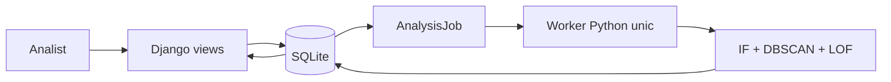

# Arhitectura SecFlow

Un monolit Django, pagini HTML pe server, SQLite și **un singur worker Python în fundal**. Workerul este necesar pentru cerința analistului: navigarea și salvarea unei cereri nu trebuie să aștepte calculele algoritmilor. Nu folosim Redis, Celery sau un API separat.

## Responsabilități

| Loc | Rol |
|---|---|
| `core/models.py` | Conturi cu identități fictive, tranzacții, coadă, evaluări, cazuri, note și audit. |
| `core/views.py` | Permisiuni, filtre, pagini și salvarea cererilor, fără calcul sincron de scor. |
| `core/background.py` | Pune în coadă, preia și procesează un job. |
| `core/services.py` | Import, replay și evaluarea unei singure tranzacții. |
| `detection/pipeline.py` | Politica comună de scor și parametrii impliciți. |
| `detection/algorithms.py` | Cei trei algoritmi de la zero. |
| `detection/features.py` | Istoric cauzal și normalizare pe referință. |
| `detection/forecast.py` | Estimare simplă a volumului de alerte, doar în profilul clientului. |
| `core/demo.py` | Nume fictive stabile și dosare istorice etichetate demonstrative. |
| `templates/`, `static/` | Interfață și actualizarea paginii care așteaptă un rezultat. |

## Fluxul unei cereri

1. Django validează formularul și salvează tranzacția cu o decizie în așteptare.
2. În aceeași tranzacție SQLite creează un `AnalysisJob` cu starea `queued`.
3. Workerul preia următorul job și îl marchează `running` printr-o actualizare condiționată.
4. Construiește caracteristicile numai până la cererea respectivă. Cererile mai noi, chiar deja salvate, sunt excluse.
5. Ajustează referința mică și execută IF, LOF și DBSCAN prin același pipeline folosit de replay.
6. Salvează evaluarea, eventualul caz, restricția și încheierea jobului atomic.
7. Pagina verifică doar starea jobului, apoi afișează rezultatul. Nu rulează algoritmi din JavaScript sau din cererea HTTP.

O eroare anulează rezultatele parțiale, marchează jobul `failed` și lasă workerul să continue. Administratorul poate relua analizele eșuate din administrare. La repornire, workerul recuperează joburile întrerupte. Un lock de proces împiedică pornirea accidentală a doi workeri pentru aceeași bază. Implementarea locală folosește `fcntl`, disponibil pe macOS/Linux.

`run_demo` pornește webul și workerul cu o singură comandă. În dezvoltare pot rula separat `runserver` și `analysis_worker`. Bootstrap-ul `setup_demo` face sincron importul și analiza inițială; operațiile din platformă sunt procesate în fundal.

## Clienți, conturi și istoric

Pentru simplitate, un obiect `Account` reprezintă contul unui client demonstrativ și păstrează numele fictiv. Nu creăm utilizatori Django pentru clienții băncii: utilizatorii de autentificare sunt doar administratorul și analiștii. Acest prototip nu modelează toate conturile posibile ale unei persoane.

ID-ul sursă rămâne cheia stabilă. Un nume determinist și un identificator public `MIA-…` sunt doar prezentare; acesta nu este un IBAN valid. Numele nu intră în vectorii de detecție. Profilul arată cererile trimise/primite, dosarele active și închise și istoricul restricțiilor.

Dosarele istorice sunt pregătite dintr-un subset stabil de scenarii generate etichetate, cu notă demonstrativă și moment de închidere în timpul simulării. Nu suprascriem investigații cu note existente. Concluzia unui astfel de exemplu folosește eticheta cunoscută numai după detecție, fără a pretinde o investigație bancară reală.

## Fiabilitate și limite

Autentificare, permisiuni în backend, CSRF, ORM și operații atomice. Decizia inițială, evaluările ulterioare și restricția contului rămân distincte. Deblocarea nu execută retroactiv un transfer.

SQLite permite un singur writer. Workerul procesează secvențial, iar replay-ul mare poate ține un lock de scriere până la încheiere. Portofoliul implicit este potrivit prezentării locale, nu unui serviciu bancar concurent. Coada este durabilă, dar un proces de supraveghere extern ar fi necesar pentru repornire automată după oprirea sistemului.

PaySim rămâne un experiment separat. Interfața MIA folosește scenariile generate, afișate în MDL demonstrativi, cu o dată de început fixă a simulării. Nu există integrare sau autorizare din partea BNM.
