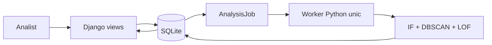

# Arhitectura SecFlow

Un monolit Django, pagini HTML pe server, SQLite și **un singur worker Python în fundal**. Workerul este necesar pentru cerința analistului: navigarea și salvarea unei cereri nu trebuie să aștepte calculele algoritmilor. Nu folosim Redis, Celery sau un API separat.

## Responsabilități

| Loc | Rol |
|---|---|
| `core/models.py` | Conturi cu identități fictive, tranzacții, coadă, evaluări, cazuri, note și audit. |
| `core/views.py` | Permisiuni, filtre, pagini și salvarea cererilor, fără calcul sincron de scor. |
| `core/playback.py` | Ceas persistent, redare automată cu backpressure și repetare fără ștergerea istoricului. |
| `core/monitoring.py` | Proiecții pentru grafice, coadă, latență și starea workerului. |
| `detection/mia.py` | Referință și validare separate, semnale continue pentru MIA. |
| `detection/risk.py` | Scor gradual, opt contribuții explicate și pragurile politicii. |
| `datasets/demo_mia.py` | Set mic, reproductibil, integral sintetic. |
| `core/background.py` | Pune în coadă, preia și procesează un job. |
| `core/services.py` | Import, replay și evaluarea unei singure tranzacții. |
| `detection/pipeline.py` | Politica comună de scor și parametrii impliciți. |
| `detection/algorithms.py` | Cei trei algoritmi de la zero. |
| `detection/features.py` | Istoric cauzal și normalizare pe referință. |
| `detection/forecast.py` | Estimare simplă a volumului de alerte, doar în profilul clientului. |
| `core/demo.py` | Nume fictive stabile și dosare istorice etichetate demonstrative. |
| `templates/`, `static/` | Interfață și actualizarea paginii care așteaptă un rezultat. |

## Fluxul unei cereri

1. Django validează formularul și salvează tranzacția cu o decizie în așteptare.
2. În aceeași tranzacție SQLite creează un `AnalysisJob` cu starea `queued`.
3. Workerul preia următorul job și îl marchează `running` printr-o actualizare condiționată.
4. Construiește caracteristicile numai până la cererea respectivă. Cererile mai noi, chiar deja salvate, sunt excluse.
5. Ajustează referința mică și execută IF, LOF și DBSCAN prin același pipeline folosit de replay.
6. Salvează evaluarea, eventualul caz, restricția și încheierea jobului atomic.
7. Pagina verifică doar starea jobului, apoi afișează rezultatul. Nu rulează algoritmi din JavaScript sau din cererea HTTP.

O eroare anulează rezultatele parțiale, marchează jobul `failed` și lasă workerul să continue. Diagnosticul este păstrat în `AnalysisJob.error`; o cerere eșuată poate fi repusă în coadă din shell sau administrarea Django, care nu apare în navigația platformei. La repornire, workerul recuperează joburile întrerupte. Un lock de proces împiedică pornirea accidentală a doi workeri pentru aceeași bază. Implementarea locală folosește `fcntl`, disponibil pe macOS/Linux.

`run_demo` pornește webul și workerul cu o singură comandă. În dezvoltare pot rula separat `runserver` și `analysis_worker`. Bootstrap-ul `setup_demo` face sincron importul și analiza inițială; operațiile din platformă sunt procesate în fundal.

## Clienți, conturi și istoric

Pentru simplitate, un obiect `Account` reprezintă contul unui client demonstrativ și păstrează numele fictiv. Nu creăm utilizatori Django pentru clienții băncii: utilizatorii de autentificare sunt doar administratorul și analiștii. Acest prototip nu modelează toate conturile posibile ale unei persoane.

ID-ul sursă rămâne cheia stabilă. Un nume determinist și un identificator public `MIA-…` sunt doar prezentare; acesta nu este un IBAN valid. Numele nu intră în vectorii de detecție. Profilul arată cererile trimise/primite, dosarele active și închise și istoricul restricțiilor.

Dosarele istorice sunt pregătite dintr-un subset stabil de scenarii generate etichetate, cu notă demonstrativă și moment de închidere în timpul simulării. Nu suprascriem investigații cu note existente. Concluzia unui astfel de exemplu folosește eticheta cunoscută numai după detecție, fără a pretinde o investigație bancară reală.

## Fiabilitate și limite

Autentificare, permisiuni în backend, CSRF, ORM și operații atomice. Decizia inițială, evaluările ulterioare și restricția contului rămân distincte. Deblocarea nu execută retroactiv un transfer.

SQLite permite un singur writer. Workerul procesează secvențial, iar replay-ul mare poate ține un lock de scriere până la încheiere. Portofoliul implicit este potrivit prezentării locale, nu unui serviciu bancar concurent. Coada este durabilă, dar un proces de supraveghere extern ar fi necesar pentru repornire automată după oprirea sistemului.

PaySim rămâne un experiment separat. Interfața MIA folosește scenariile generate, afișate în MDL demonstrativi, cu o dată de început fixă a simulării. Nu există integrare sau autorizare din partea BNM.

## Dashboard și scenariu automat

`setup_demo` generează CSV-ul MIA reproductibil și îl importă idempotent. Analizează doar primele 1.280 de cereri. Ultimele 240 au `visible=False`: nu intră în liste, exporturi, profiluri, grafice, cazuri sau scorare. Detaliile unui transfer viitor întorc 404. Referința și validarea sunt exclusiv anterioare fluxului.

`DemoPlayback` păstrează starea running/paused/completed, intervalul de 3 secunde, numărul cererilor redate și heartbeat-ul workerului. La fiecare pas, `tick()` publică cel mult o cerere ascunsă, în ordine cronologică, și o pune în aceeași coadă ca o cerere manuală. Dacă există analiză în așteptare sau în curs, ceasul așteaptă. O cerere publicată este analizată de IF, LOF și DBSCAN, apoi rezultatul este salvat atomic. Timpul simulat nu revine în trecut nici după cereri manuale.

Pauza oprește publicarea de cereri, nu calculul unei cereri deja primite. Repornirea aplicației păstrează starea scenariului și coada. La final, butonul Reia scenariul adaugă o copie nouă a celor 240 de cereri, cu ID-uri și momente noi; nu șterge cazuri sau note.

Browserul cere o proiecție HTML la `/monitor/dashboard/` la 3 secunde. Numai panourile se înlocuiesc; intervalul, formularul de pauză și focusul rămân stabile. Fiecare panou se actualizează separat. Panoul consultat (tabel glisat, focus sau detalii deschise) își păstrează conținutul și afișează pauza cu vârsta datelor; celelalte panouri continuă să se actualizeze. Starea workerului provine din heartbeat, latența din ultimele 20 de analize individuale ale sursei, coada și erorile din joburile persistente. Latența include ajustarea modelului și salvarea, fără a include așteptarea în coadă. Metricile nu sunt valori simulate.

`/metrics/` necesită autentificare și răspunde în format text Prometheus, cu gauge-uri pentru fereastra ultimelor șase ore simulate, coadă, erori, worker și latență. Este un punct de extensie; nu adăugăm infrastructură de colectare la demo. Graficele și distribuțiile sunt calculate din aceleași rânduri vizibile în SQLite. Inspirație de organizare: [panouri Grafana](https://grafana.com/docs/grafana/latest/visualizations/dashboards/) și [metrici Prometheus](https://prometheus.io/docs/introduction/overview/).

Algoritmii sunt în cod și documentație; interfața de lucru nu afișează numele, scorurile individuale sau parametrii lor. Profilul clientului păstrează estimarea numărului de alerte pentru ora următoare. Nu folosim utilizatori reali sau conexiuni la MIA.

## Scor actual și explicații

Politica continuous-v2 combină 55 de puncte statistice cu 45 de puncte comportamentale. Explicațiile se calculează în worker și se persistă în aceeași tranzacție cu evaluarea. HTTP doar citește explicația; nu rulează modele sau calcule de atribuire.

Fiecare evaluare păstrează un JSON versionat în `Assessment.explanation`; ultima explicație este disponibilă în `Transaction.risk_explanation`. `display_risk` folosește acest scor actual, cu fallback la primul scor pentru înregistrările vechi. Decizia și scorul inițial rămân distincte pentru audit. Reanalizarea poate deschide un caz pentru un semnal nou, dar nu șterge și nu redeschide automat cazuri deja închise.

Listele clienților și profilurile arată scorul ultimului transfer evaluat. Profilul explică indicatorii de risc și elementele favorabile; un disclosure arată toate contribuțiile. Prognoza numără alertele din scorurile actuale de minimum45 în ultimele șase ore. Dashboardul separă semnalele actuale de distribuția deciziilor la primirea cererii. Pagina Rezultate citește raportul reproductibil al testului istoric original când versiunea sa corespunde politicii; replay-ul local nu îi mărește artificial testul. Exportul rezultatelor separă `historical_test` (raportul afișat) și `latest_visible_replay` (istoricul local reanalizat). Exportul CSV numește explicit `risk_current` și `decision_initial`.
