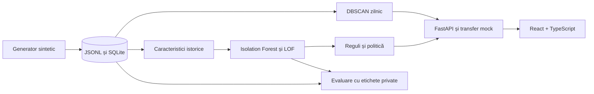

# SecFlow · proiect universitar MIA

Demo **local și complet sintetic** pentru analiza transferurilor P2P din perspectiva unui singur PSP fictiv. Nu se conectează la MIA, BNM sau la conturi bancare reale. Aceasta este aplicația integrată din repository-ul SecFlow: backendul, datasetul și evaluarea MIA sunt prezentate printr-o interfață inspirată din SecFlow. Aplicația Django anterioară rămâne doar ca referință istorică.

## Ce demonstrează

- **Isolation Forest** caută plăți care se abat de la comportamentul global; **LOF** caută plăți rare față de vecini comparabili. Ambele sunt antrenate fără etichete de fraudă.
- **Regulile explicite** descriu contextul: multe încercări recente, dispozitiv nou, destinatar nou, sumă peste mediana personală ori ieșire rapidă după încasări.
- Politica combină rangurile și regulile într-un **scor 0–100 de triere**, apoi decide `Permit`, `Verify` sau `Block`. Scorul **nu este probabilitate de fraudă**.
- **DBSCAN** grupează separat ferestre zilnice de cont. O constatare de tip punct rar sau ciclu local este indiciu de investigat, nu verdict.
- React arată șase zone: monitorizare, tranzacții, investigație, conturi, simulator și evaluare. Frontendul comunică **numai cu FastAPI** și folosește limbajul vizual alb/albastru SecFlow.

## Pornire rapidă

Cerințe: Python 3.12, [uv](https://docs.astral.sh/uv/), [Node.js 24 LTS](https://nodejs.org/en/about/previous-releases) și npm. Din acest folder:

```bash
uv sync --extra dev --frozen
cd frontend && npm ci && cd ..
```

Datele, modelul, raportul și baza SQLite sunt deja generate pentru demo. Pentru regenerare reproductibilă:

```bash
uv run mia-demo all --robustness
```

Comanda folosește sămânța 42, 400 de conturi, 10.000 de cereri și 100 de zile fixe, 13 iulie–20 octombrie 2026. Reproduce evaluarea, dar baza existentă nu se reinițializează automat; pentru o bază curată, elimină **doar** `data/demo.sqlite3` din acest subproiect înainte de comandă. Etichetele sintetice sunt păstrate separat în `data/private/`.

Pornește în două terminale din acest folder:

```bash
uv run uvicorn mia_demo.api:app --host 127.0.0.1 --port 8001
```

```bash
cd frontend && npm run dev -- --port 5173
```

Deschide [interfața locală](http://127.0.0.1:5173). [Documentația API](http://127.0.0.1:8001/docs) este disponibilă separat. Vite redirecționează `/api` către FastAPI; poți schimba ținta locală cu `MIA_API_PROXY_TARGET`. Pentru un host static, configurează aceeași rutare sau `VITE_API_BASE_URL` la build. După reantrenare, repornește API-ul pentru a încărca noul model.

Pentru verificare:

```bash
uv run pytest -q
cd frontend && npm ci && npm test && npm run build
```

## Demonstrație orală de cinci minute

1. Arată volumul sintetic în **Prezentare generală** și filtrarea cu paginare în **Tranzacții**.
2. În **Simulator**, alege presetul **Obișnuită** și trimite plata. Deschide investigația persistată și explică istoricul anterior, IF, LOF, regulile și starea plății.
3. Creează o **Cerere nouă**, alege **Atipică** și deschide cazul `Verify`. Aprobă sau respinge prin revizuirea simulată. Decizia originală rămâne `Verify`; jurnalul de audit înregistrează acțiunea. Repetă cu **Viteză mare** pentru `Block`: presetul creează cinci încercări observate înaintea plății, fără etichetă de fraudă.
4. În **Conturi locale**, arată intrările, ieșirile și constatările DBSCAN cu timpul lor de disponibilitate.
5. În **Evaluare modele**, compară precizia, recall și alarmele false. Spune explicit că testul final are 2.000 de cereri și 20 de scenarii etichetate; performanța este valabilă numai pentru generatorul nostru.

## Arhitectură



`src/mia_demo/` conține generatorul, caracteristicile, modelele, politica, API-ul și evaluarea. `frontend/src/api/client.ts` este singurul punct de acces HTTP din interfață. `data/DATASET.md` explică proveniența și separările temporale; `docs/ALGORITHMS.md` explică algoritmii; `reports/methodology.md` descrie experimentul. Capturile `reports/react-*.png` documentează interfața din proiectul sursă; versiunea SecFlow integrată este verificată separat în `docs/INTEGRATION.md`.

## Limite

Datele sunt inventate. Unele fraude autorizate prin inginerie socială sunt asemănătoare plăților legitime; setul final are cazuri ratate și alarme false. SQLite și serverul cu un singur proces sunt potrivite doar pentru demo. Fișierele `joblib` trebuie încărcate numai din artefactele locale de încredere.
